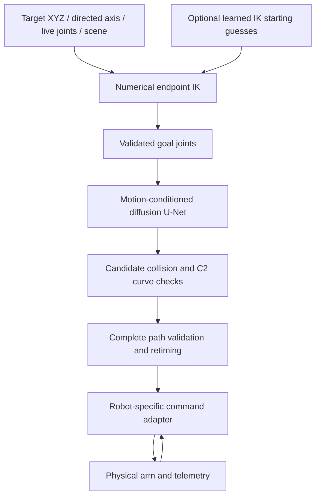

# Build and port the current diffusion robot planner

Procedure version: 2026-10-08. Reference implementation: myCobot 280 Pi,
`diffusion_motion_v2`, with optional learned numerical-IK starting guesses.

This procedure explains how to reproduce the architecture and build a new
robot-specific model. Use a separate project copy and fresh artifact folders
for another arm. The active myCobot weights remain tied to its geometry, limits
and feature schema; a new robot needs its own data, model identity and evaluation.
The commands below are instructions only; writing this procedure does not run
training, deploy a model or move the robot.

## 1. Define the task and reference architecture

The current task is target XYZ plus directed tool-local Z in the base frame.
Rotation about that tool axis is free. It is a five-dimensional endpoint task;
applications requiring a complete tool orientation need a different goal/IK
contract and corresponding labels. First define whether the new arm needs the
same task, full pose, position only, or another objective.

Runtime pipeline:



Current model: a conditional temporal Conv1d U-Net with channels 32/64/128,
observation/time-conditioned FiLM residual blocks and skip connections.
It predicts Gaussian noise for six-joint, sixteen-position action chunks.
DDPM training uses 100 cosine noise timesteps and epsilon prediction. The active
planner samples four candidates with 32 denoising steps. Its checked virtual
rollout advances up to 0.4 seconds per decision, then updates its motion inputs.
The full route is generated before fixed-target hardware execution.

The original v1 EMA was trained on a 1,000-episode dataset. Current motion-v2
expands the observation from 19 to 34 and fine-tunes that robot-compatible
initialization for 20,000 steps on 100,000 original expert episodes plus 20,000
motion/no-block augmentations. The active checkpoint SHA-256 is:

`6582cbf4e1d2575007cfead8f99ed5f15a7b7021083d0eb200c61b224401bddc`

The experimental one-pass transformer is not the current diffusion model.
The new 1,000-episode collision-protected set is a separate artifact: it was
used by the transformer experiment, not by the currently active diffusion weights.

**Output:** written task contract, robot identifier, desired goal convention,
workspaces and model version names.

## 2. Build a robot adapter and versioned schema

Collect the URDF or equivalent verified kinematic description, collision meshes,
installed joint order/types, measured zero/sign conventions, base and TCP frames,
attached tool geometry, and robot-supported position/velocity/acceleration limits.
Intersect mechanical, firmware and application limits; choose an inward operating
margin appropriate to the new arm. Do not reuse the myCobot SDK arrays.

Use metres, radians and seconds internally for revolute arms. Convert degrees,
millimetres and encoder counts only at input/transport boundaries. If the arm
has prismatic joints, their positions are metres and derivatives are m/s and
m/s²; update the schema, mixed-unit metric, normalization, IK and command adapter.
Continuous joints need an explicit unwrapped operating window or a winding-aware
planner/encoder representation. The present bounded-joint implementation does not
handle wraparound by itself.

| Robot contract | Required implementation |
|---|---|
| Joint count N, names and types | One ordering across FK, learning, simulation and transport |
| Base and TCP | Include tool transforms and actual collision geometry |
| Limits | Hardware bounds, inward operating bounds and motion envelope |
| FK and Jacobian | Shared transforms for dataset labels, IK and runtime checks |
| Normalize/denormalize | `(q - centre) / radius` using fixed operating bounds |
| Collision validity | Bounds, self, table/workspace and represented obstacles |
| Scene encoding | Geometry and presence features matching training/runtime |
| Hardware interface | Read state, send references, Stop, health and lease checks |

For the current one-box schema and N revolute joints:

- Base observation: current N + goal N + box geometry 6 + presence 1 = `2N + 7`.
- Motion extras: joint velocity N + joint acceleration N + target velocity 3.
- Full observation: `4N + 10` (34 when N=6).
- Diffusion actions and predicted noise: `[batch, N, horizon]`, horizon currently 16.
- Returned candidates: `[requests, samples, horizon, N]`.
- Optional IK-start model: input `N + 6`, output `K × N` for K proposals.

These formulas apply to this goal/schema choice. Full orientation, additional
obstacles or mixed joint types require a new schema rather than width-only checks.
The service dispatches by semantic schema, not just observation width.

**Code to port:** `simulation/kinematics.py`, `joint_limits.json`,
`self_collision.py`, `workspace.py`, `prm.py`; diffusion `common.py`, `env.py`,
`motion_conditioning.py`, `model.py`, `policy.py`, dataset/train/evaluation code;
`simulation/continuous.py`, `motion_limits.py`, and any selected hardware adapter.
Six-joint and robot-name assumptions appear across these modules and the WebUI.

Use a targeted search during the port:

```bash
rg -n \
  'myCobot|mycobot|joint6_flange|Expected six|shape.*6|zeros\(6|OBS_DIM|34|4096|V2_SHA256' \
  simulation webui hardware
```

The U-Net currently hardcodes six input/output channels and accepts only 19/34
observation widths. The IK-start network and some free-spin loss assumptions are
also myCobot-specific. A different joint count needs code changes before any
command in later sections is useful.

**Gate:** FK, Jacobians, joint ordering, units, bounds and normalization agree
between the adapter and simulator over deterministic poses and random valid poses.
Compare FK with manufacturer/controller measurements where available; do not
substitute a different DH convention silently.

## 3. Verify collision geometry and the timing envelope

Build conservative collision geometry with correct mesh units and link origins.
Exclude only intentionally allowed contact pairs, such as verified adjacent links.
Check base, table, fixtures, tool, gripper and held objects that can affect clearance.
The current experiment uses convex hulls, 1 mm modeled clearance, a fixed table
and one axis-aligned box. Those are reference settings, not universal settings.
Choose clearance to reflect the new geometry accuracy and operational needs. If the new tool or obstacles change, include those changes in both the collision model and model/scene identity.

Verify known-safe poses, known-colliding poses, joints near operating limits and
paths whose endpoints are safe but whose interiors collide. Replay connecting
segments; valid endpoints do not establish a valid path. For narrow routes,
confirm that finer sampling does not change the accepted labels.

Put the new arm's actual joint, TCP and angular motion limits in the retiming
contract. The old generator's 1 rad/s and 3 rad/s² vector bounds alone do not
prove compliance with additional TCP/angular limits. The current runtime also
uses a conservative manufacturer motion envelope in `motion_limits.py`.

**Important observed issue:** 16/24 historical incoming-motion labels exceeded
the present conservative runtime envelope in the Oct 8 comparison; 17 starting
braking continuations were rejected for both policies. For a new robot, retime
demonstrations under the same complete envelope used at runtime, then recompute
velocity/acceleration labels. Check every nonzero initial motion against that
envelope before labeling retarget examples. Keep runtime gates intact.

After shortcutting, curve fitting and timing, independently replay the exact
final analytic curve. The added collision-protected generator checks at 100 Hz
and connecting-edge spacing 0.01 rad, in a fresh scene. For another arm, choose
sampling based on geometry and motion; a joint step in radians is not appropriate
for prismatic joints. Finite checks remain sampled kinematic evidence.

**Output:** robot/scene hashes, collision-pair policy, motion profile, independent
geometry verification and positive/negative path fixtures.

## 4. Generate expert demonstrations and motion augmentation

Run the following from the adapted project's root with fresh outputs. The shown
CLI flags match this repository for its six-joint implementation; complete the
adapter/schema port first. Change worker/batch counts to fit the new machine.

Use a GPU workstation for training; the new arm can retain its own controller or a network bridge. In the current system, GPU planning runs on the host and packets reach the Pi/arm separately. Benchmark deployment inference on the intended host rather than assuming the robot controller can run the network.

Create a Python environment, install a CUDA-compatible PyTorch build, then the
collision/diffusion requirements. Existing dependency ranges and captured versions
are in `simulation/diffusion/requirements.txt` and
`output/trajectory_transformer_environment_20261008.json`. Preserve a package
lock/version record for the new build. Do not rely on an unrestricted pip upgrade
to reproduce an older checkpoint.

```bash
python3 -m venv .venv
.venv/bin/python -m pip install -r simulation/diffusion/requirements.txt
.venv/bin/python -c 'import torch; print(torch.__version__, torch.cuda.is_available())'
```

Confirm that the installed Torch is the intended CUDA build before training.
Create a 1,000-episode bootstrap set and a larger expert source:

```bash
OPENBLAS_NUM_THREADS=1 OMP_NUM_THREADS=1 .venv/bin/python \
  -m simulation.diffusion.generate_dataset \
  --output simulation/artifacts/new_arm/base/demonstrations.h5 \
  --episodes 1000 --seed 42 --blocked-fraction 0.2

OPENBLAS_NUM_THREADS=1 OMP_NUM_THREADS=1 .venv/bin/python \
  -m simulation.diffusion.generate_large \
  --output simulation/artifacts/new_arm/expert/demonstrations.h5 \
  --episodes 100000 --seed 20261005 --workers 8 --shard-size 1000 \
  --blocked-fraction 0.2 --audit-episodes 1000
```

RRT* supplies joint-space expert routes. Shortcuts must be newly collision-checked;
the timed curve and connecting edges must be checked again. Store joints,
timestamps, goal joints, FK XYZ/tool-axis labels, obstacle geometry, diagnostics,
robot identity and source hashes. Split whole episodes approximately 80/10/10;
never split windows from one route across training and test sets.

Add scene-absence, moving targets and retargets with incoming motion:

```bash
OPENBLAS_NUM_THREADS=1 OMP_NUM_THREADS=1 .venv/bin/python \
  -m simulation.diffusion.generate_motion \
  --source simulation/artifacts/new_arm/expert/demonstrations.h5 \
  --output simulation/artifacts/new_arm/motion/augmentation.h5 \
  --episodes 20000 --workers 8
```

Augmented children inherit their parent's split. Validate shapes, finite values,
FK labels, limits, derivatives, target velocity, unique parent IDs and splits.
`audit_motion` has fixed defaults in its module entry point; custom paths require
the callable rather than invented CLI flags:

```python
from pathlib import Path
from simulation.diffusion.audit_motion import audit

audit(
    Path('simulation/artifacts/new_arm/expert/demonstrations.h5'),
    Path('simulation/artifacts/new_arm/motion/augmentation.h5'),
    Path('output/new_arm_motion_audit.json'),
    sample_size=1000,
)
```

For broader collision training, the ported protected generator adds diverse boxes,
direct-blocked detours, no-block routes and valid near-boundary endpoints:

```bash
OPENBLAS_NUM_THREADS=1 OMP_NUM_THREADS=1 .venv/bin/python \
  -m simulation.diffusion.generate_collision_protected \
  --output simulation/artifacts/new_arm/protected/demonstrations.h5 \
  --episodes 1000 --workers 4 --seed 202610082
```

Its rejected neighboring poses are in `hard_negatives`, separate from action
labels. The current diffusion trainer does not use a collision-classifier loss.
Do not feed unsafe states into positive trajectories. For extra obstacles beyond
the one-box schema, first add a new observation representation and matching
runtime collision scene.

**Gate:** all published positive curves pass final replay; splits and parent
lineage are disjoint; examples and start motion obey the actual runtime envelope.

## 5. Train a new base policy, then motion-conditioned v2

The current v2 training script expects a compatible 19-feature base checkpoint.
For a different robot, train that base from scratch using the new robot's data.
The myCobot pretrained checkpoint will fail the robot identity check; do not
bypass that check. Transfer learning across arms would require a separate,
explicitly designed experiment.

```bash
OPENBLAS_NUM_THREADS=1 OMP_NUM_THREADS=1 CUBLAS_WORKSPACE_CONFIG=:4096:8 \
  .venv/bin/python -m simulation.diffusion.train \
  --dataset simulation/artifacts/new_arm/base/demonstrations.h5 \
  --output simulation/artifacts/new_arm/base/model \
  --device cuda --epochs 80 --batch-size 512 --channels 32 --seed 42

OPENBLAS_NUM_THREADS=1 OMP_NUM_THREADS=1 CUBLAS_WORKSPACE_CONFIG=:4096:8 \
  .venv/bin/python -m simulation.diffusion.train_motion \
  --source simulation/artifacts/new_arm/expert/demonstrations.h5 \
  --augmentation simulation/artifacts/new_arm/motion/augmentation.h5 \
  --initial simulation/artifacts/new_arm/base/model/diffusion_policy_6dof.pth \
  --cache simulation/artifacts/new_arm/motion/cache \
  --output simulation/artifacts/new_arm/motion/model \
  --steps 20000 --batch-size 512
```

The legacy filename `diffusion_policy_6dof.pth` persists in current scripts. If N
changes, rename/generalize all readers together; the filename alone is not a
valid model contract.

Training windows use the next sixteen absolute normalized joint positions.
The first label is q[t+1]; short terminal tails repeat the endpoint. Every window
stays inside its episode. Fixed operating bounds define normalization; never
estimate it from held-out targets. Motion features are current velocity,
acceleration and Cartesian target velocity with robot-appropriate versioned scales.

Add Gaussian noise at one of 100 DDPM timesteps and train noise MSE. Use AdamW,
cosine learning-rate decay, gradient checks and EMA. Select weights with fixed-seed
validation noise MSE. Never select checkpoints using the rollout test suite.
The current base uses learning rate 0.001; motion fine-tuning uses 0.0003. These
are reference hyperparameters, not demonstrated optima for another arm.

`train_motion` currently reads exactly two sources: original expert data and one
augmentation file, sampled equally by episode then frame. It has no third-source
`--protected` option. To include the protected set as well as motion augmentation,
extend the cache builder, sampler, split audit and provenance to support multiple
named sources. Retain schema/masks and episode end indices, and document weights.
Do not concatenate files blindly or claim the current model included this new set.
The transformer experiment's three-source loader illustrates the separation,
not a drop-in diffusion training command.

**Output:** robot-specific checkpoint, training JSON/history, selected EMA step,
dataset/cache/source hashes, package/CUDA versions, seed and reproducible command.

## 6. Optional: train learned IK starting guesses

Numerical endpoint IK is required by the active joint-goal conditioned v2 route.
A learned start model can improve search but is optional; first establish the
new arm's FK/Jacobian and strict numerical IK behavior.

For the same task and a six-joint port:

```bash
OPENBLAS_NUM_THREADS=1 .venv/bin/python -m simulation.diffusion.ik_seed_data \
  --output simulation/artifacts/new_arm/ik/dataset.npz \
  --train-targets 16000 --validation-targets 512 --test-targets 256 \
  --currents-per-target 2 --seed 202610071

OPENBLAS_NUM_THREADS=1 CUBLAS_WORKSPACE_CONFIG=:4096:8 \
  .venv/bin/python -m simulation.diffusion.train_ik_seed \
  --dataset simulation/artifacts/new_arm/ik/dataset.npz \
  --output simulation/artifacts/new_arm/ik/model \
  --device cuda --steps 8000 --batch-size 512
```

FK witnesses and current poses must be scene-valid. Split target groups before
pairing current poses. The current network is 12 → 256 → 256 → 48, yielding eight
six-joint guesses. It runs after current-pose IK fails. Numerical refinement,
FK tolerances, bounds and live-scene validity decide acceptance; raw network
outputs cannot authorize an endpoint or a path.

The current IK-start dataset has no optional block and its features contain no
obstacle geometry. Runtime refinement checks the requested scene. If learned
obstacle-aware endpoint branches are needed, create another schema and model.
Also port the current q1–q5 witness penalty: excluding joint 6's spin is specific
to this arm/task; it is not a general rule for every wrist or redundant arm.

**Gate:** compare learned-enabled/disabled numerical IK using the same strict
endpoint tolerance, seeds and search budgets; verify export parity and safe
missing/incompatible-model fallback.

## 7. Evaluate the complete checked planner

Freeze the selected checkpoint before scoring test data. Use the same tasks,
controller, seeds and budgets for candidate and baseline. Evaluate:

- No-block, diverse obstacle, blocked-detour and boundary cases.
- Fixed goals, moving targets and nonzero-motion retargets.
- Endpoint success/error, raw unsafe proposals, safe refusals and stalls.
- Complete-path collision replay, derivative bounds and C2 joins.
- Warmed, synchronized GPU inference and complete planning latency separately.
- Several task seeds and, when feasible, independent training seeds.

Retain a classical expert planner as an offline reference. Do not secretly repair
neural test rollouts with RRT* and then count them as pure neural successes.
Explicit near-goal capture and fallback policies must be identical and labeled
in paired comparisons. Include equal-duration holds when comparing tracking
RMSE so early completion is treated consistently.

Reuse `compare_motion.tasks`, `motion_suite`, `compare_continuous.fixed_motion_tasks`
and `fixed_duration_metrics` after porting their joint/schema assumptions.
Existing `compare_continuous` entry points pin myCobot paths and model IDs;
create a new robot-specific evaluation driver with explicit paths. There is no
universal new-robot comparison CLI in this repository yet.

Current runtime default: seed 42, four candidates, 32 denoising steps, at most
200 decisions, deadline 90 s checked between decisions. C2 rollout advances up
to 0.4 s at 0.02 s reference spacing; a rejected replacement can retain a checked
braking tail. The entire completed path and smoothed/retimed playback are checked
again. Unsafe or exhausted full plans return no executable partial route.

The reference endpoint gate is ≤1 mm and ≤1° directed tool-axis error. Define and
record appropriate new-robot tolerances before evaluation. Numerical search
exhaustion is not proof of physical unreachability. Low validation noise MSE or
collision-free training data alone does not establish planner reliability.

**Gate:** pass prespecified task/clearance/motion/error requirements, with complete
failed-case traces and uncertainty limits. Confirm unsupported scene inputs and
changed robot/schema/checkpoint identity fail safely.

## 8. Build the hardware adapter and qualify it separately

Use the new robot's official command units and measured interface behavior.
The myCobot adapter converts a checked q(t) and analytic dq/dt into six encoder
targets and speed words, then sends SET_ENCODERS_DRAG through TCP and a Pi serial
bridge. Its nominal 4096 counts/revolution, direction signs, 0.2 s cadence and
speed-word behavior are robot-specific. They must not be copied to another arm.

A different driver might accept joint positions with timestamps, position/speed
packets or a manufacturer trajectory API. Define readback, command acknowledgement,
queueing, cancellation, freshness, fault state and Stop behavior. Use the checked
route and calibrated TCP/zero/sign mapping; recheck quantized/discretized targets.
Bound the live-to-command transition and preserve checked corners. Handle Stop,
heartbeat expiry, stale plans, transport disconnect and tracking error explicitly.

Start with read-only state/units/health verification and software fault-injection
checks. Hardware qualification then uses a clear workspace, small checked routes,
conservative measured speed and recorded command/state timestamps. Evaluate
tracking error, endpoint settling, latency, lost messages and fault recovery
before expanding range or complexity. Simulation inertias in this experiment are
placeholders; these tests establish actuator/transport behavior separately.

The myCobot execution endpoint allowances currently differ from planning: stopped
URDF-FK position ≤5 mm, direction ≤3°, quantized joint arrival 0.75°, stable for
0.5 s, with a further 10 s settling budget. These are recorded implementation
settings, not defaults for another robot. The existing myCobot settling timeout
is unresolved; reusing the architecture does not resolve physical tracking.

**Output:** robot-specific driver, calibrated mapping, tracking/settling evidence,
fault tests and explicit allowed execution envelope.

## 9. Package, activate and retain a rollback

Package the checkpoint with robot/geometry/tool hashes, joint order/types and
bounds, task/frame convention, feature names/order/scales, horizon, scheduler,
training completion, data/source hashes and evaluation report hashes. Pin both
the manifest and model hashes. Load weights using a strict schema and finite
checks, preserving the current mismatch rejection behavior.

The current `deploy_motion.py` copies the original myCobot manifest, assumes a
100,000-episode source count, checks motion-v2 report fields and writes the active
manifest pointer. `webui/hardware_diffusion.py` also pins the current myCobot
model name/hash. Port these intentionally for a new robot; the existing deploy
entry point is not a generic arm installer. Use explicit robot-specific paths
and a new model identity rather than weakening checks or changing a hash alone.

Activate only the evaluated package for that robot. Record the previous active
manifest/checkpoint, use an atomic pointer update, verify status after loading,
and retain the previously verified package for rollback. A new robot requires
its own verified initial deployment; an old myCobot package is not its fallback.

Keep a build bundle containing:

| Deliverable | Evidence |
|---|---|
| Robot contract | URDF/tool geometry, limits, frames, calibration |
| Dataset | Positive HDF5, separate negatives, hashes and split audits |
| Model | Base and motion checkpoints, EMA selection and training history |
| IK | Numerical checks; optional start model/export/paired evaluation |
| Simulation evaluation | Frozen tasks, successes/refusals, collision and timing traces |
| Hardware qualification | Tracking/settling, transport/Stop and fault evidence |
| Deployment | Pinned manifest, model/data/report hashes and rollback record |

## 10. Reference files in this project

- Robot adapter: `simulation/kinematics.py`, `joint_limits.json`, `self_collision.py`.
- Scene/planner: `simulation/diffusion/env.py`, `planner.py`, `simulation/continuous.py`, `motion_limits.py`.
- Data: `generate_dataset.py`, `generate_large.py`, `generate_motion.py`, `audit_motion.py`, `generate_collision_protected.py`.
- Learning: `common.py`, `dataset.py`, `model.py`, `train.py`, `train_motion.py`, `policy.py`, `motion_conditioning.py`.
- Runtime/deployment: `service.py`, `continuous_rollout.py`, `deploy_motion.py`.
- Optional IK: `endpoint_ik.py`, `ik_seed.py`, `ik_seed_data.py`, `train_ik_seed.py`, `IK_SEED.md`.
- Hardware reference: `webui/hardware_diffusion.py`, `hardware_ik.py`, `fixed_profile.py`, `encoder_profile.py`, `encoder_drag.py`, `hardware/pi_server.py`.
- Current workflow details: `simulation/diffusion/README.md`; `output/reports/latest_model_workflow_report_20261008.pdf`.
- Latest candidate comparison: `output/reports/transformer_comparison_20261008.pdf` and `output/trajectory_transformer_comparison_20261008.json`.

Documentation was checked against local implementation and artifact metadata.
Training commands were checked against their CLI definitions; they were not
executed while preparing this procedure. No other-arm portability has yet been
implemented or physically qualified in this project.
